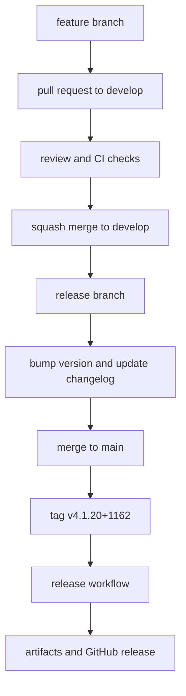
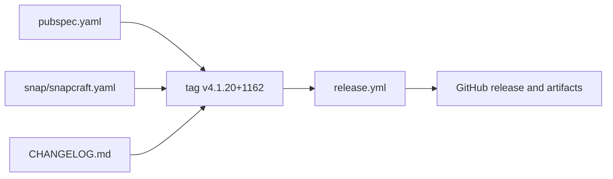

# Version Control Guide for REChain

> **Current release:** `v4.1.20+1162` — 2026-10-21
> **Source of truth:** [`pubspec.yaml`](pubspec.yaml) → [`CHANGELOG.md`](CHANGELOG.md) → [`RELEASE_NOTES.md`](RELEASE_NOTES.md)
> **Release automation:** [`.github/workflows/release.yml`](.github/workflows/release.yml) — triggered by tags matching `v*`

This guide describes how REChain versions its code, branches, commits and releases. It is aligned with the current
[`CHANGELOG.md`](CHANGELOG.md) entry (`v4.1.20+1162`, 2026-10-21) and is the reference document for maintainers,
release managers and contributors.

---

## Table of Contents

1. [Versioning Scheme](#versioning-scheme)
2. [Where the Version Lives](#where-the-version-lives)
3. [Changelog-Driven Development](#changelog-driven-development)
4. [Branching Model](#branching-model)
5. [Tags and Release Triggers](#tags-and-release-triggers)
6. [Commit Conventions](#commit-conventions)
7. [Release Flow](#release-flow)
8. [Hotfix Flow](#hotfix-flow)
9. [Version Synchronization and Checks](#version-synchronization-and-checks)
10. [Git Hooks and CI Gates](#git-hooks-and-ci-gates)
11. [Rollback and Tag Hygiene](#rollback-and-tag-hygiene)
12. [Troubleshooting](#troubleshooting)
13. [Tools and Resources](#tools-and-resources)

---

## Versioning Scheme

REChain uses **Semantic Versioning with a monotonically increasing build number**:

```
MAJOR.MINOR.PATCH+BUILD
   4  .  1  .  20  +1162
```

| Part | Meaning | When to increment |
|------|---------|-------------------|
| `MAJOR` | Incompatible changes to public APIs, data schema or protocol | Breaking change accepted and documented in `CHANGELOG.md` |
| `MINOR` | Backward-compatible functionality | New features, new integrations, new platforms |
| `PATCH` | Backward-compatible fixes | Bug fixes, stability and performance improvements |
| `BUILD` | Internal build counter (Flutter build number) | **Every** release, including re-releases of the same `MAJOR.MINOR.PATCH` |

Rules:

- `BUILD` is **strictly increasing** and is never reused, even for a re-tag of the same patch version.
- A release that only bumps `BUILD` is a valid release and must have its own `CHANGELOG.md` entry.
- Pre-release identifiers follow SemVer and precede the build metadata: `4.1.21-rc.1+1163`, `4.1.21-nightly.2+1164`.
- Nightly and stable channels reuse the same version core but differ by pre-release suffix and distribution channel
  (`config.nightly.py`, `config.stable.py`, F-Droid `-nightly` / `-stable` tracks).
- The `+BUILD` part is **not** part of SemVer precedence — two builds with the same core are ordered by `BUILD` only
  inside REChain distribution channels.

### Version history (from `CHANGELOG.md`)

| Version | Date | Notes |
|---------|------|-------|
| `4.1.20+1162` | 2026-10-21 | Current release: messaging, navigation and stability improvements |
| `4.1.10+1160` | 2025-12-06 | Matrix, Telegram, blockchain, IPFS, AI, plugin system, unified API |
| `4.1.10+1152` | 2025-07-08 | Architecture and benchmark baseline |
| `4.1.9+1147` | — | Pre-ecosystem release |

---

## Where the Version Lives

`pubspec.yaml` is the **single source of truth** for the application version. Everything else either derives from it
or must be updated in the same commit.

| File | Field | Derivation | Current value |
|------|-------|-----------|---------------|
| [`pubspec.yaml`](pubspec.yaml) | `version:` | **Source of truth** | `4.1.20+1162` |
| [`snap/snapcraft.yaml`](snap/snapcraft.yaml) | `version:` | Manual — must match `pubspec.yaml` | `4.1.20+1162` |
| [`android/app/build.gradle.kts`](android/app/build.gradle.kts) | `versionCode` / `versionName` | `flutter.versionCode` / `flutter.versionName` from `pubspec.yaml` | derived |
| `ios/Flutter/Generated.xcconfig` | `FLUTTER_BUILD_NAME` / `FLUTTER_BUILD_NUMBER` | Generated by `flutter pub get` / `flutter build` | derived |
| `web/`, `linux/`, `windows/`, `macos/` builds | asset `version.json` | Generated at build time | derived |
| [`fdroid/metadata/com.rechain.online.yml`](fdroid/metadata/com.rechain.online.yml) | `versionName`, `versionCode`, `commit`, `CurrentVersion`, `CurrentVersionCode` | Manual | update per release |
| [`appimage/com.rechain.online.appdata.xml`](appimage/com.rechain.online.appdata.xml) | `<release version=... date=...>` | Manual | update per release |
| [`aurora/CMakeLists.txt`](aurora/CMakeLists.txt) | `PROJECT_VERSION` | Manual | update per release |
| [`RELEASE_NOTES.md`](RELEASE_NOTES.md) | Title and summary | Manual | update per release |
| [`CHANGELOG.md`](CHANGELOG.md) / `CHANGELOG.txt` | Release entry | Manual, kept in sync | update per release |

Notes:

- **Never** edit `Generated.xcconfig`, `version.json`, `build/` or `dist/` artifacts by hand — they are generated.
- Android `versionCode` is taken from the `+BUILD` part, so a monotonic `BUILD` guarantees store-compatible upgrades.
- F-Droid metadata uses a composite `versionCode` built from the version components
  (for example `41101160` for `4.1.10+1160`, `41201162` for `4.1.20+1162`). Update it together with
  `versionName`, `commit`, `CurrentVersion` and `CurrentVersionCode`, then run `fdroid lint`.
- The Snap version is **not** derived automatically — a stale `snap/snapcraft.yaml` was the exact reason the
  repository contained `4.1.20+1161` while the app was already at `4.1.20+1162`.

---

## Changelog-Driven Development

REChain releases are **changelog-driven**: a release exists only if it is described in `CHANGELOG.md`.

> **Rule:** no `CHANGELOG.md` entry — no tag, no build, no release.

### Entry format

Entries are ordered **newest first** and follow the format already used in [`CHANGELOG.md`](CHANGELOG.md):

```markdown
## [v4.1.20+1162] - 2026-10-21

### Features & Improvements
- ...

### Stability & Bug Fixes
- ...

### Performance & Reliability
- ...

### Compatibility
- ...

### Build
- Updated application version to `4.1.20+1162`.
```

Requirements:

- Heading is exactly `## [vMAJOR.MINOR.PATCH+BUILD] - YYYY-MM-DD` and stays consistent with the git tag and with
  `pubspec.yaml` (`v4.1.20+1162` tag ↔ `4.1.20+1162` in `pubspec.yaml`).
- The date is the planned or actual release date (UTC), not the date of the first commit.
- Use the established sections: `Features & Improvements`, `Stability & Bug Fixes`, `Performance & Reliability`,
  `Compatibility`, `Build`. Security-related items go to a `Security` section when applicable.
- The `Build` section must state the new version string — this is what reviewers check against `pubspec.yaml`.
- Work in progress is collected under `## [unreleased] - YYYY-MM-DD` and renamed to the final version at release time.
- `CHANGELOG.txt` mirrors `CHANGELOG.md`; regenerate it in the same commit.
- Store-facing notes (`fastlane/metadata/android/*/changelogs/`) are short user-facing digests of the same entry.

### Mapping commits to changelog sections

| Commit type | Changelog section |
|-------------|-------------------|
| `feat` | `Features & Improvements` |
| `fix` | `Stability & Bug Fixes` |
| `perf` | `Performance & Reliability` |
| `refactor`, `chore`, `build`, `ci` | `Build` (only if user-visible) |
| `security` / `fix` with security impact | `Security` |
| `docs` | not listed unless user-facing |

---

## Branching Model

REChain follows a lightweight Git Flow with short-lived branches and a protected `main`.

### Long-lived branches

| Branch | Purpose | Protection |
|--------|---------|-----------|
| `main` | Production-ready code; every commit is releasable | No direct pushes, required review, required CI, linear history preferred |
| `develop` | Integration branch for the next release | No direct pushes, required CI |

### Short-lived branches

| Pattern | Purpose | Base branch | Merge target |
|---------|---------|-------------|--------------|
| `feature/<short-name>` | New feature | `develop` | `develop` (squash) |
| `bugfix/<short-name>` | Non-critical fix | `develop` | `develop` (squash) |
| `release/<version>` | Release stabilization, version bump, changelog | `develop` | `main` + back-merge to `develop` |
| `hotfix/<short-name>` | Urgent production fix | `main` | `main` + back-merge to `develop` |
| `docs/<short-name>` | Documentation only | `develop` | `develop` |
| `chore/<short-name>` | Tooling, CI, dependencies | `develop` | `develop` |

Branch naming rules:

- Lowercase, hyphen-separated, ASCII only: `feature/space-navigation-rail`, `bugfix/avatar-clipping`.
- No personal prefixes, no ticket-less vague names (`feature/update`, `fix/stuff` are rejected).
- Release branches include the target version: `release/4.1.20`.

### Merging strategy

| Source → Target | Strategy | Reason |
|-----------------|----------|--------|
| `feature/*` → `develop` | Squash merge | One reviewable commit per feature |
| `bugfix/*` → `develop` | Squash merge | Clean history |
| `release/*` → `main` | Merge commit | Preserves the release boundary |
| `release/*` → `develop` | Merge commit (back-merge) | Keeps `develop` aligned |
| `hotfix/*` → `main` | Merge commit | Traceable emergency change |
| `main` → `develop` | Merge commit | Never rebase a shared branch |

Local cleanup before pushing:

```bash
git fetch origin
git rebase origin/develop
git push --force-with-lease origin feature/my-branch
```

`--force-with-lease` is mandatory; plain `--force` is forbidden on shared branches.



---

## Tags and Release Triggers

Tags are the **only** mechanism that produces a release.

- Format: annotated tag `vMAJOR.MINOR.PATCH+BUILD`, for example `v4.1.20+1162`.
- The tag **must** be created on a commit already merged into `main`.
- The tag **must** match the `version:` field in `pubspec.yaml` and the newest `CHANGELOG.md` heading.
- Annotated tags are required (`git tag -a`), signed tags are recommended (`git tag -s`).
- `+` is legal in git refs but must be URL-encoded as `%2B` in web URLs:
  `https://github.com/sorydima/REChain-/releases/tag/v4.1.20%2B1162`.

Creating and pushing a tag:

```bash
git checkout main
git pull --ff-only
git tag -a v4.1.20+1162 -m "REChain 4.1.20+1162"
git push origin v4.1.20+1162
```

What the tag triggers in [`.github/workflows/release.yml`](.github/workflows/release.yml):

1. `flutter pub get`
2. `flutter build apk --release`, `appbundle`, `ios --no-codesign`, `web`, `linux`, `windows`
3. Upload of the six artifact bundles
4. `softprops/action-gh-release` publishing the GitHub release with those artifacts

Because the workflow matches `v*`, **any** tag starting with `v` publishes a release. Never push exploratory tags such
as `v-test`, `v-next` or `v4.1.20-rc1` to `origin` unless a release is actually intended — use a local tag or a
branch instead.

---

## Commit Conventions

Commits follow [Conventional Commits](https://www.conventionalcommits.org/):

```
type(scope): description

[optional body]

[optional footer]
```

### Types and their version impact

| Type | SemVer impact | In changelog |
|------|---------------|--------------|
| `feat` | `MINOR` | `Features & Improvements` |
| `fix` | `PATCH` | `Stability & Bug Fixes` |
| `perf` | `PATCH` | `Performance & Reliability` |
| `refactor` | none (usually) | optional |
| `docs` | none | no |
| `test` | none | no |
| `build`, `ci`, `chore` | none | only if user-visible |
| `revert` | depends on reverted commit | yes |
| `BREAKING CHANGE:` footer | `MAJOR` | required |

### Scope examples

`chat`, `rooms`, `spaces`, `auth`, `crypto`, `media`, `notifications`, `settings`, `matrix`, `telegram`, `ipfs`,
`blockchain`, `ai`, `ui`, `i18n`, `android`, `ios`, `linux`, `windows`, `web`, `snap`, `flatpak`, `ci`, `docs`, `deps`.

### Examples

```
feat(chat): add background audio player

fix(ui): prevent crash when resizing window in chat

perf(rooms): preload server file config before upload

docs(version-control): document changelog-driven release flow

build(snap): bump snapcraft version to 4.1.20+1162

feat(api)!: drop legacy REST v0 endpoints

BREAKING CHANGE: REST v0 is removed; migrate to the unified API.
```

Subject line rules: imperative mood, ≤ 72 characters, no trailing period, no emoji in the subject.
Body explains **why**, not **what**. Reference issues and PRs in the footer (`Refs: #123`, `Closes: #456`).

---

## Release Flow

End-to-end flow for a normal release (example: `4.1.20+1162`):

1. **Freeze scope.** `develop` is green, all release-blocking PRs are merged.
2. **Create the release branch.** `git checkout -b release/4.1.20 develop`
3. **Bump the version** in `pubspec.yaml` (`version: 4.1.20+1162`).
4. **Sync derived/manual version files:** `snap/snapcraft.yaml`, F-Droid metadata, AppImage appdata, Aurora
   `CMakeLists.txt`, `RELEASE_NOTES.md`.
5. **Write the changelog.** Rename `## [unreleased]` to `## [v4.1.20+1162] - 2026-10-21`, fill the sections, mirror
   into `CHANGELOG.txt`, update `fastlane` store notes.
6. **Verify** with the checks from [Version Synchronization and Checks](#version-synchronization-and-checks).
7. **Open a PR** `release/4.1.20` → `main`; complete [`RELEASE_CHECKLIST.md`](RELEASE_CHECKLIST.md).
8. **Merge to `main`** with a merge commit.
9. **Tag and push** `v4.1.20+1162` (see [Tags and Release Triggers](#tags-and-release-triggers)).
10. **Watch the release workflow** in [`.github/workflows/release.yml`](.github/workflows/release.yml); confirm all six
    artifact bundles and the GitHub release.
11. **Publish** to stores and package channels (Google Play, App Store, F-Droid, Snap Store, Flatpak, AppImage,
    Aurora/DEB/RPM, web, Vercel).
12. **Back-merge** `main` → `develop` so the version bump is not reintroduced as a merge conflict later.
13. **Announce** via the channels listed in [`SUPPORT_CHANNELS.md`](SUPPORT_CHANNELS.md) and update
    [`Roadmap.md`](Roadmap.md).



Definition of done:

- [ ] `pubspec.yaml` and `snap/snapcraft.yaml` carry the same version
- [ ] `CHANGELOG.md` top entry matches the tag, with a `Build` section
- [ ] `CHANGELOG.txt` and `fastlane` notes updated
- [ ] CI is green on `main`
- [ ] Tag is annotated, pushed, and points to a `main` commit
- [ ] Release workflow produced all artifacts
- [ ] `main` is back-merged into `develop`

---

## Hotfix Flow

For production defects that cannot wait for the next `MINOR`:

1. `git checkout -b hotfix/<short-name> main`
2. Fix the defect with a `fix` commit; add a regression test.
3. Bump `PATCH` and `BUILD` (`4.1.20+1162` → `4.1.21+1163`).
4. Add a new `CHANGELOG.md` entry — hotfixes are releases and need their own entry.
5. Open a PR `hotfix/*` → `main`, review, merge with a merge commit.
6. Tag `v4.1.21+1163` and let the release workflow publish.
7. Back-merge `main` → `develop` and, if a release branch is still open, merge into it as well.

Never tag a hotfix from a `develop` commit and never skip the changelog entry.

---

## Version Synchronization and Checks

Run these checks locally before opening the release PR, and keep them in CI:

```bash
# 1. Version in pubspec.yaml
grep -n '^version:' pubspec.yaml

# 2. Snap version must match
grep -n '^version:' snap/snapcraft.yaml

# 3. Newest changelog heading
grep -m1 '^## \[v' CHANGELOG.md

# 4. Remaining references to the previous version
grep -rn "4.1.10+1160" --include="*.md" --include="*.yaml" --include="*.yml" .
```

Expected state for the current release:

| Check | Expected |
|-------|----------|
| `pubspec.yaml` | `version: 4.1.20+1162` |
| `snap/snapcraft.yaml` | `version: 4.1.20+1162` |
| `CHANGELOG.md` first heading | `## [v4.1.20+1162] - 2026-10-21` |
| Git tag | `v4.1.20+1162` |

Recommended CI guard (pseudo-workflow) — fails the build when the tag and `pubspec.yaml` disagree:

```yaml
- name: Verify version matches tag
  if: startsWith(github.ref, 'refs/tags/v')
  run: |
    TAG_VERSION="${GITHUB_REF_NAME#v}"
    PUBSPEC_VERSION="$(grep '^version:' pubspec.yaml | awk '{print $2}')"
    SNAP_VERSION="$(grep '^version:' snap/snapcraft.yaml | awk '{print $2}' | tr -d "'")"
    test "$TAG_VERSION" = "$PUBSPEC_VERSION" || { echo "Tag $TAG_VERSION != pubspec $PUBSPEC_VERSION"; exit 1; }
    test "$TAG_VERSION" = "$SNAP_VERSION" || { echo "Tag $TAG_VERSION != snap $SNAP_VERSION"; exit 1; }
    head -n 20 CHANGELOG.md | grep -q "\[v$TAG_VERSION\]" || { echo "Missing changelog entry for $TAG_VERSION"; exit 1; }
```

Known drift points to watch on every release (they are manual, not generated):

- `snap/snapcraft.yaml` — was one build behind (`4.1.20+1161`) before this document was updated
- `fdroid/metadata/com.rechain.online.yml` — `versionName`, composite `versionCode`, `commit`
- `appimage/com.rechain.online.appdata.xml` — `<release>` entry
- `aurora/CMakeLists.txt` — `PROJECT_VERSION`
- `README_RUSSIAN_LINUX.md` badge and `RELEASE_NOTES.md` title

---

## Git Hooks and CI Gates

### Pre-commit (`.pre-commit-config.yaml`)

- formatting and linting (`dart format`, `flutter analyze`, `prettier` for Markdown/YAML)
- license header checks (`scripts/update-license-headers.sh`, `REUSE.toml`)
- trailing whitespace and end-of-file fixes

### Pre-push

- `flutter test` for touched packages
- dependency validation (`dart_dependency_validator.yaml`)
- version consistency check from the previous section

### CI on pull requests

- `.github/workflows/ci.yml` — analyze and tests
- `.github/workflows/android.yml` — Android build on `android/**` and `pubspec.yaml` changes
- `.github/workflows/codeql.yml` — static security analysis
- `.github/workflows/coverage.yml` — coverage threshold
- `.github/workflows/e2e.yml`, `e2e-rbac.yml` — end-to-end suites

A red pipeline is a hard blocker: no review approval can override it, and no release tag is created while `main` is red.

---

## Rollback and Tag Hygiene

- **Never move or delete a published tag.** Consumers and stores cache tags; rewrite history only with an explicit
  maintainer decision recorded in the release issue.
- If a release is broken, ship a new `PATCH` + `BUILD` (`4.1.21+1163`) — do not re-tag `4.1.20+1162`.
- If a tag was pushed by mistake and no release was published, delete it locally and remotely **before** the workflow
  finishes, then document the incident:

```bash
git tag -d v4.1.20+1162
git push origin :refs/tags/v4.1.20+1162
```

- Shorebird patches follow the same rule: patch content is described in the changelog and referenced in the release
  notes; patches never change the public version.
- Reverts use `git revert` on `main` plus a changelog entry; history is never rewritten on shared branches.

---

## Troubleshooting

| Symptom | Cause | Fix |
|---------|-------|-----|
| Release workflow built an older version | Tag pushed before the version bump landed on `main` | Delete the tag (if unpublished), merge the bump, re-tag |
| Snap version differs from the app | `snap/snapcraft.yaml` is manual | Update it in the same commit as `pubspec.yaml` |
| "Version code already used" in a store | `BUILD` was reused | Increment `BUILD` and cut a new release |
| GitHub release URL with `+` is broken | `+` not encoded | Use `%2B` in URLs |
| Changelog heading does not match the tag | Entry renamed after tagging | Fix the entry in a follow-up commit; never re-tag |
| CI version check fails on a tag build | Tag/`pubspec.yaml` mismatch | Align the tag with `pubspec.yaml` or vice versa before publishing |
| Two release branches open at once | Missing back-merge | Merge the older release into `develop` before cutting the next one |

---

## Tools and Resources

- Git documentation: https://git-scm.com/doc
- Conventional Commits: https://www.conventionalcommits.org/
- Semantic Versioning: https://semver.org/
- GitHub Flow: https://docs.github.com/en/get-started/using-github/github-flow
- Flutter versioning: https://docs.flutter.dev/deployment/android#versioning-the-app
- Project references: [`CHANGELOG.md`](CHANGELOG.md), [`RELEASE_NOTES.md`](RELEASE_NOTES.md),
  [`RELEASE_PROCESS.md`](RELEASE_PROCESS.md), [`RELEASE_CHECKLIST.md`](RELEASE_CHECKLIST.md),
  [`CONVENTIONS.md`](CONVENTIONS.md), [`DEPRECATION_POLICY.md`](DEPRECATION_POLICY.md)

---

*This version control guide is part of the REChain documentation suite and is current for release `v4.1.20+1162`
(2026-10-21).*
