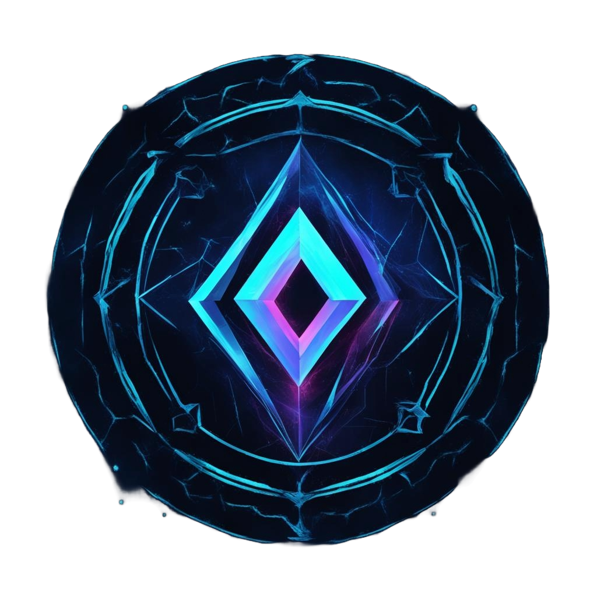

# REChain Aurora OS README
# Version: 4.1.20+1162
# Last Updated: 2026-10-21

---

<p align="center">
  
</p>

<h1 align="center">REChain for Aurora OS</h1>

<p align="center">
  <strong>Secure, Decentralized Matrix Messenger for Aurora OS</strong>
</p>

<p align="center">
  <a href="https://github.com/sorydima/REChain-/releases">
    
  </a>
  <a href="https://github.com/sorydima/REChain-/blob/main/LICENSE">
    
  </a>
  <a href="https://matrix.to/#/#chatting:matrix.katya.wtf">
    
  </a>
</p>

---

## 📱 About

REChain for Aurora OS is a secure, decentralized messaging client built on the
Matrix protocol with deep integration into Aurora OS features.

### Key Features

- 🔐 **End-to-End Encryption** - Olm/Megolm protocol for secure messaging
- 💬 **Matrix Protocol** - Decentralized, federated communication
- 🔔 **Native Notifications** - Aurora OS integration with notification center
- 🎨 **Aurora Design** - Native Silica UI components
- 🌐 **Federation** - Connect with any Matrix server worldwide
- 🌉 **Bridges** - Connect with Telegram, Discord, and more
- 📱 **Responsive UI** - Adapts to different screen sizes
- 🔋 **Battery Optimized** - Efficient background processing
- 🛡️ **Privacy First** - No tracking, no ads, no data collection

---

## 🚀 Quick Start

### Installation

#### RPM Package (Recommended)

```bash
# Download the RPM package
wget https://github.com/sorydima/REChain-/releases/download/v4.1.20+1162/com.rechain.online-4.1.20+1162-1.armv7hl.rpm

# Install
sudo rpm -ivh com.rechain.online-4.1.20+1162-1.armv7hl.rpm
```

#### DEB Package

```bash
# Download the DEB package
wget https://github.com/sorydima/REChain-/releases/download/v4.1.20+1162/com.rechain.online_4.1.20+1162_armhf.deb

# Install
sudo dpkg -i com.rechain.online_4.1.20+1162_armhf.deb
sudo apt-get install -f  # Fix dependencies
```

#### From Source

```bash
# Clone the repository
git clone https://github.com/sorydima/REChain-.git
cd REChain-/aurora

# Build
mkdir build && cd build
cmake .. -DCMAKE_BUILD_TYPE=Release
make -j$(nproc)

# Install
sudo make install
```

### First Run

1. Find REChain in your application menu or launcher
2. Tap to open
3. Enter your Matrix server URL (or use default)
4. Sign in or create account
5. Start messaging!

---

## 📋 Features

### Messaging

- 💬 Text messages
- 📷 Images and videos
- 🎤 Voice messages
- 📎 File attachments
- 📍 Location sharing
- 🔗 URL previews
- 📝 Edit messages
- 🗑️ Delete messages
- ↩️ Reply to messages
- 📊 Message status (sent, delivered, read)

### Encryption

- 🔐 End-to-end encryption
- 🔑 Key verification
- 📱 Device management
- 💾 Secure key backup
- ⚠️ Security alerts
- 🛡️ Trust tracking

### Rooms

- 👥 Group chats
- 🔗 Room links
- #️⃣ Room aliases
- 🏷️ Room avatars
- 📋 Member list
- 🔒 Private rooms
- 🌐 Public rooms
- 📢 Room addresses

### Aurora OS Integration

- 🔔 Native notifications
- 🎨 Silica UI components
- 📱 Activity lifecycle
- 🔋 Battery optimization
- 🖥️ Multi-window support
- 👆 Touch gestures
- 📐 Responsive layout
- 🌙 Dark mode

---

## 🛠️ Development

### Build Requirements

- Aurora SDK 4.0+
- Qt5.15+ (Qt6 not yet supported)
- Flutter SDK 3.32.8+
- CMake 3.16+
- C++20 compiler
- libflutter-embedder

### Build Instructions

See [BUILD_GUIDE.md](BUILD_GUIDE.md) for detailed build instructions.

### Project Structure

```
aurora/
├── CMakeLists.txt          # Build configuration
├── main.cpp                # Application entry point
├── AutonomousNotificationService.cpp/h  # Notification service
├── CrashReportingManager.cpp/h  # Crash reporting
├── AuroraSystemIntegration.cpp/h  # System integration
├── config/
│   ├── rechain.conf        # Application configuration
│   └── logging.conf        # Logging configuration
├── desktop/
│   └── com.rechain.online.desktop  # Desktop entry
├── icons/                  # Application icons
├── rpm/
│   └── com.rechain.online.spec  # RPM spec file
└── BUILD_GUIDE.md          # Build documentation
```

---

## 📚 Documentation

- [BUILD_GUIDE.md](BUILD_GUIDE.md) - Build instructions
- [AURORA_INTEGRATION.md](AURORA_INTEGRATION.md) - Aurora OS features
- [CHANGELOG.md](CHANGELOG.md) - Version history
- [API Documentation](https://github.com/sorydima/REChain-/wiki)

---

## 🤝 Contributing

Contributions are welcome! Please see our contributing guidelines:

- [Contributing Guide](https://github.com/sorydima/REChain-/blob/main/CONTRIBUTING.md)
- [Code of Conduct](https://github.com/sorydima/REChain-/blob/main/CODE_OF_CONDUCT.md)
- [Security Policy](https://github.com/sorydima/REChain-/blob/main/SECURITY.md)

### Ways to Contribute

- 🐛 Report bugs
- 💡 Suggest features
- 📝 Improve documentation
- 🔧 Submit pull requests
- 🌍 Translate the app
- 💰 Support development

---

## 📞 Support

- **GitHub Issues:** Report bugs and request features
- **Matrix Community:** [#chatting:matrix.katya.wtf](https://matrix.to/#/#chatting:matrix.katya.wtf)
- **Email:** dim15168250@yandex.ru
- **Aurora OS Forum:** https://forum.aurora-os.org

---

## 📄 License

REChain is licensed under the Apache License 2.0.

```
Copyright © 2019-2026 REChain Inc.

Licensed under the Apache License, Version 2.0 (the "License");
you may not use this file except in compliance with the License.
You may obtain a copy of the License at

    http://www.apache.org/licenses/LICENSE-2.0

Unless required by applicable law or agreed to in writing, software
distributed under the License is distributed on an "AS IS" BASIS,
WITHOUT WARRANTIES OR CONDITIONS OF ANY KIND, either express or implied.
See the License for the specific language governing permissions and
limitations under the License.
```

---

## 🙏 Acknowledgments

- **Matrix.org** - For the Matrix protocol and reference implementation
- **Aurora OS** - For the mobile Linux platform
- **Flutter** - For the cross-platform UI framework
- **The Matrix Community** - For contributions and support

---

<p align="center">
  Made with ❤️ by the REChain Team
</p>

<p align="center">
  <strong>REChain: Building the Digital Infrastructure of Autonomous Organizations</strong> 🚀
</p>

